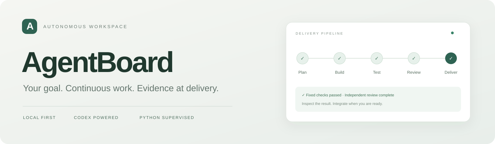
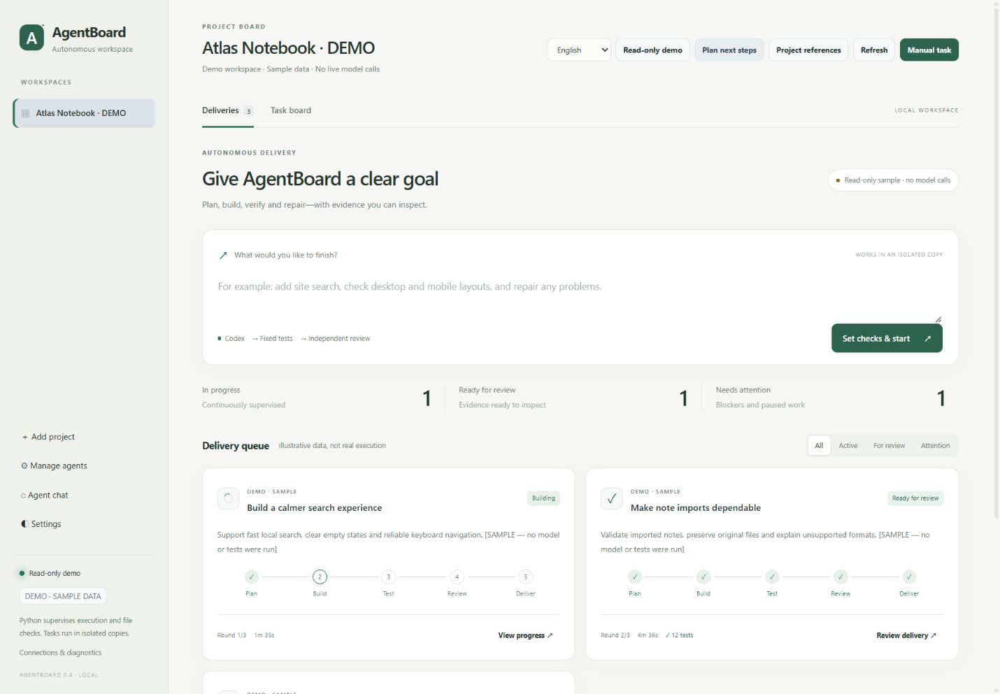

<p align="center"></p>

<p align="center"><strong>A local workspace for Codex to plan, build, test and repair its work.</strong><br>Give it a goal. Follow the evidence. Review the delivery.</p>

<p align="center"><a href="README.zh-CN.md">简体中文</a> · <a href="#quick-start">Quick start</a> · <a href="docs/新手指南.md">Beginner guide (中文)</a> · <a href="docs/AUTONOMY.md">Autonomous delivery guide</a> · <a href="docs/SETUP.md">Setup</a> · <a href="CHANGELOG.md">Changelog</a></p>

## From a goal to a delivery

AgentBoard keeps the work moving after the first model response. A durable Python supervisor runs Codex in an isolated project copy, executes fixed acceptance checks, asks a separate Codex session to review the result, and sends concrete failures back for repair. You decide when to integrate the changes into the original project.

| Describe | Let it work | Inspect the result |
| --- | --- | --- |
| Choose a project, goal, allowed files and real checks. | Plan → build → program checks → independent review → bounded repair. | Read test output, screenshots, review findings, code diffs and the delivery report. |



*Public screenshots use the built-in read-only demo. Sample cards are illustrative; they are not evidence of real model execution.*

## New in 0.4 — autonomous delivery

The **2026-11-04 source update** brings same-Wi-Fi phone access, separate phone pages, clearer agent bubble colors and corrected group-discussion rounds. The working tree has passed 250 Python offline tests on Windows and 51 JavaScript regressions for phone login and group-chat routing. Browser checks covered navigation, simulator conversations, project creation/linking, deletion/restoration and draft preservation. Android Chrome pairing and workspace entry were confirmed on a real device; the new layout's touch and soft-keyboard experience still needs device review. These changes are included in this GitHub source update; it does not create a packaged release or tag.

- **Start with an idea.** Agent chat opens in free discussion with Codex selected. No project folder is required, and project references/source snapshots are not attached. A permanent scope selector also opens conversations for an existing project while preserving unsent drafts when switching.
- **Choose the project when ready.** Explicitly link an idle conversation to an existing project, or create a project from the discussion and keep its history. New folders require an explicit checkbox; project creation does not start a model or task. Active replies continue in the background when you switch conversations.
- **Keep the board tidy.** Move unused tasks or projects to the recycle bin and restore them later. Project deletion hides its tasks and conversations; local source files, history and integrated changes remain. Restore does not start tasks or undo file changes.
- **Durable progress.** SQLite checkpoints and an append-only event history survive a service restart. Paused jobs stay paused. Interrupted work returns to its recorded phase when automatic recovery is enabled.
- **Checks the builder cannot rewrite.** Existing acceptance files are hashed before work. A successful exit with zero discovered tests fails acceptance. Syntax checks alone cannot establish delivery.
- **Independent review.** A fresh Codex session reviews a read-only snapshot and actual check evidence. Serious findings return the task to the builder, within your round and time limits.
- **Browser evidence.** Static HTML projects can be opened in an installed Edge/Chrome at desktop and phone sizes. The receipt includes actual PNG captures, measured viewport dimensions, horizontal-overflow and visible-text checks. This does not replace interaction tests or human visual review.
- **Bounded, controllable execution.** Pause, resume and stop; per-call deadline up to 25 minutes; total time, repair-round and no-progress limits. Python supervises without repeated model polling.
- **Clearer workspace.** Goal-first home, delivery status filters, detailed receipts, mobile navigation and a right-side agent conversation workspace. Chinese/English and three optional themes remain available.
- **Read-only diagnostics.** Check CLI/login, actual quota, browser availability and database health. An idle-only restart applies backend updates without terminating unrelated Python processes.

## Keep the whole project in context

Discuss an idea before choosing a project, then link the conversation when its direction is clear. Switching the scope selector opens another conversation; moving an existing discussion requires an explicit link action. Linking preserves history, removes the earlier task link and marks old consensus for review.

For project work, attach development logs, handoffs, local documents and reference pages. Discuss a plan in one shared room, address a single agent with a slash command, save consensus and turn it into a task. Chat's task button creates an ordinary task draft; use **Deliveries** for the autonomous check/review/repair workflow. Task capsules, source diff, protected files, explicit integration and hash-guarded rollback remain available.

Codex is the autonomous delivery executor. DeepSeek Harness and custom CLI/API adapters remain available for their documented task or discussion capabilities; they do not automatically inherit the new Codex review loop. Simulators allow configuration rehearsal without an account. [Agent guide](docs/AGENTS.md) · [Model settings](docs/MODEL_SETTINGS.md)

Group chat's ordinary **Send** uses the visible round selector: each invited member replies once per round. Two members at two rounds allow four replies; three rounds allow six. Python schedules subsequent turns, without relying on model handoffs. All members explicitly indicating they can finish may end a complete round early; quota, errors, stopping and the total 25-minute/six-reply cap can also end a batch, with a visible reason. `/all` requests each member once; directed messages and one-member rooms reply once. Codex bubbles use blue, DeepSeek purple, and custom members receive distinct colors while keeping sender names visible.

## Quick start

Python 3.10+ is enough for the app. No Python packages, frontend build or cloud account are required for the demo.

```bash
git clone https://github.com/wangzane355-cmyk/AgentBoard.git
cd AgentBoard
python demo.py
```

Explore the read-only demo at **http://127.0.0.1:8766/**. To use your own projects:

```bash
python launch.py
```

On Windows, double-click `start.cmd`. Open **http://127.0.0.1:8765/** and start a free discussion, or add a project and attach its reference files when ready to work on it. Install and authenticate the [official Codex CLI](https://github.com/openai/codex) for real autonomous jobs; AgentBoard reuses the local login. Node is needed for Node tests; webpage checks use Node 22+ built-ins and installed Edge/Chrome, with no npm packages. Diagnostics never calls a model. [Setup guide](docs/SETUP.md)

1. Explore an idea in **Agent chat**, or write a small, specific project goal on **Deliveries**.
2. Select a fixed verification recipe, scope and limits. Save a draft or explicitly start.
3. Follow progress or leave the service running. Failures feed the repair loop.
4. Inspect the receipt and diff. **Accept** integrates checked changes; **Revert** restores the recorded original if no newer edits conflict.

## Android access on the same Wi-Fi

**Included in the 2026-11-04 source update. Android Chrome pairing and workspace entry were verified on a real device.** On the computer, open **Settings → Phone access** and explicitly enable the separate private-IP listener (default port **8767**). The normal computer address stays on **127.0.0.1:8765**. If Windows permission is missing, select **Allow phone connections in Windows** and approve the operating-system prompt.

Connect the phone to the same trusted Wi-Fi, open the displayed address (for example, **http://192.168.1.20:8767/**), and enter the computer's eight-digit pairing code. The code is single-use and expires after five minutes. A paired device stays signed in for up to 30 days; revoke it on the computer, or disable phone access to revoke every device immediately.

Use the phone to discuss ideas, select existing projects and create projects with folders created by the computer. Desktop-only operations include service restart, executor configuration and native path selection. Keep the computer awake with AgentBoard running; closing the phone page does not stop tasks.

On screens up to 760px, the bottom navigation opens **Chats, Projects, Tasks and Me** as separate pages. Tap a conversation to continue it, open a project for discussion/tasks/references, or filter autonomous and manual tasks by project and status. **Me** opens appearance, language and the recycle bin; paired phones also have a sign-out entry.

Conversations fill the screen with readable, agent-colored bubbles and a bottom composer. Chat's **⋯** menu opens separate context, member, history and consensus/task pages; return without losing the draft or reading position. Browser checks used artificial sample data at phone, reduced-height and desktop sizes, covering navigation, forms, themes and languages without real model calls. Android touch and soft-keyboard experience still needs device review. Pairing and execution rules are unchanged.

Phone access uses HTTP: pairing is access control, **not transport encryption**. Use only trusted Wi-Fi, never a public-facing port or router forwarding. [Phone setup and connection help](docs/SETUP.md#android-phone--安卓手机同一-wi-fi) · [Security boundary](SECURITY.md)

## Real limits, visible evidence

The account guard reads the signed-in Codex account's actual available quota windows, including weekly-only readings. It blocks new Codex calls at 15% remaining, on stale readings, unavailable quota or account restrictions. Missing five-hour capacity stays unavailable. Reported invocation tokens are not a prediction of subscription capacity.

The default is one autonomous worker; an opt-in environment setting allows two. Total limits and checks apply to each job. Chat reply budgets remain bounded to six replies, with strict directed routing.

**This is a local early release, primarily verified on Windows.** Source copies and hash checks are not an OS security boundary. Use trusted projects. The main service remains loopback-only by default. Optional paired phone access is limited to a trusted private network; it is not a public-hosting or multi-user permission system. Private state, transcripts, receipts and worker copies remain outside source releases. No automatic GitHub publication or source integration happens at delivery. Deletion of source files is not automatically integrated.

Automatic recovery requires the Python service to be running again; this release does not install an OS boot service. Recovery uses recorded work and fresh Codex sessions, not a continuously preserved model process. General browser interaction automation, automatic long-history summarization and token-by-token chat streaming are not implemented. Linux/macOS live-executor behavior has not been fully validated.

## Development and distribution

```bash
python -m unittest discover -v
node --check static/autonomy.js
python doctor.py
python package_release.py
```

Offline tests use temporary projects and fake model responses. Live model trials are separate. The source packaging command uses an explicit public-file whitelist and produces a SHA256 manifest; local runtime data and credentials are excluded. The 2026-11-04 update synchronizes source code to GitHub; a source commit, a locally generated archive and a formal GitHub Release are separate deliverables.

[Architecture](docs/ARCHITECTURE.md) · [Contributing](CONTRIBUTING.md) · [Security](SECURITY.md) · [Agent handoff](DEEPSEEK_HANDOFF.md) · [Research and sources](docs/AUTONOMY_RESEARCH_2026-11-03.md)

## License

[MIT](LICENSE). Built with the Python standard library and plain HTML/CSS/JavaScript. AgentBoard is independent of OpenAI and DeepSeek. External executors retain their own licenses and terms. Task-board inspiration includes [Vibe Kanban](https://github.com/BloopAI/vibe-kanban); its code is not bundled.
