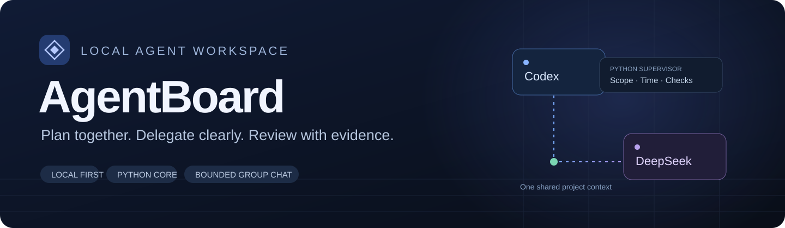
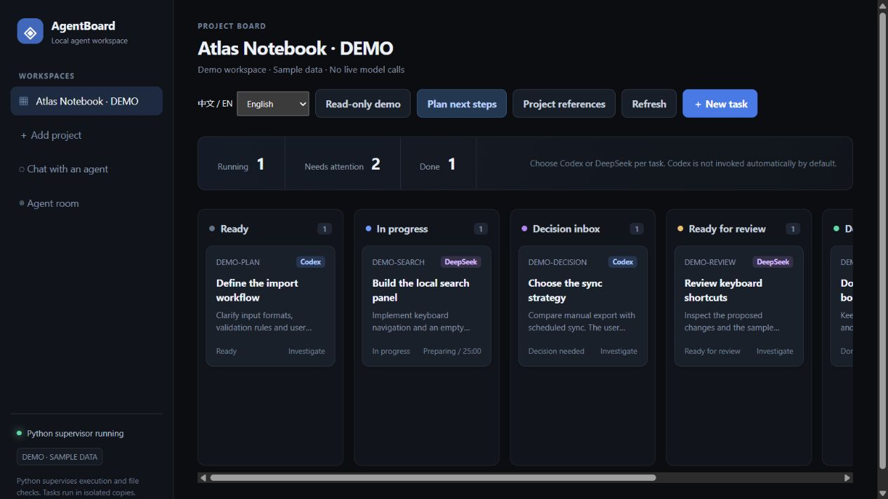
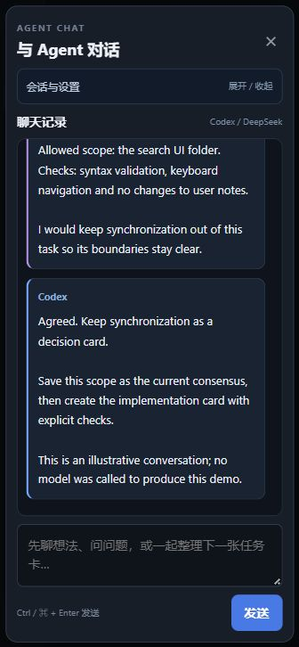
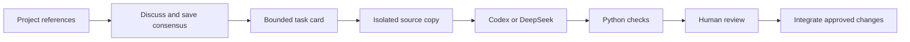

<p align="center"></p>

<p align="center">
  <a href="LICENSE"></a>
  
  
  
</p>

<p align="center"><strong>A shared workspace for planning, delegating and reviewing Codex + DeepSeek work.</strong><br>
Discuss the plan. Turn decisions into bounded tasks. Let Python supervise the execution.</p>

<p align="center"><a href="README.zh-CN.md">简体中文</a> · <a href="#quick-start">Quick start</a> · <a href="docs/SETUP.md">Agent setup</a> · <a href="docs/ARCHITECTURE.md">Architecture</a> · <a href="CONTRIBUTING.md">Contribute</a></p>

---

## A conversation that leads to a deliverable

AgentBoard connects the discussion and delivery stages of a local project. Codex and DeepSeek share project references and task context. A small Python service handles time limits, file checks and handoff records, so routine supervision does not require another model turn.

| Plan | Delegate | Review |
| --- | --- | --- |
| Discuss next steps with project logs and task dependencies already attached. | Choose an executor, allowed paths, acceptance rules and a time limit. | Read the evidence, inspect changes and explicitly integrate the result. |

## See it in action

### Project board



### Shared agent room



*Screenshots use the built-in, read-only demo workspace. Cards and conversations are illustrative sample data, not reports of real agent execution.*

## What you can do

- **Use Chinese or English.** Switch the interface language in the header or an open dialog. Your browser remembers the choice; project data and conversation text keep their original language.
- **Choose your executor.** Use Codex, DeepSeek or a configured custom adapter. Try a local simulator without an account. The default task limit is 25 minutes.
- **Plan together.** Use a shared room, direct an individual agent, or allow a bounded discussion.
- **Carry project context forward.** Attach local logs, documentation folders or webpages; refresh their snapshots before a turn.
- **Keep discussions connected to work.** Save a consensus, create a task draft, or update an existing task.
- **Collect evidence with Python.** Check process exit, allowed paths, protected files, project drift and configured acceptance rules.
- **Review before integration.** Preview text changes, keep source backups and reject rollback over newer edits.
- **Protect Codex capacity.** Read the signed-in account's five-hour window and stop new Codex calls at 15% remaining or when the reading fails.

## Quick start

### 1. Explore without an account

Python 3.10+ is enough for the application and demo. There are no third-party Python runtime dependencies.

```bash
git clone https://github.com/wangzane355-cmyk/AgentBoard.git
cd AgentBoard
python demo.py
```

Open **http://127.0.0.1:8766/**. The demo is read-only and never starts a model.

### 2. Start your own workspace

```bash
python launch.py
```

On Windows, you can also double-click `start.cmd`. Open **http://127.0.0.1:8765/**, add a local project, and attach its reference documents.

Live work additionally needs the executor you choose:
- **Codex:** install and authenticate the [Codex CLI](https://github.com/openai/codex).
- **DeepSeek:** install [DeepSeek Harness](https://github.com/deepseek-ai/deepseek-harness) and configure the `headless` profile's credentials.

See the [setup guide](docs/SETUP.md) before the first live call. Accounts and model access are supplied by each user.

## Group chat, without an endless loop

| Send | Result |
| --- | --- |
| A normal message to **All** | Each member replies once, sequentially. |
| `/codex Review this plan` | Only Codex is invoked. |
| `/deepseek Propose the smallest implementation` | Only DeepSeek is invoked. |
| `/讨论 2 Compare the approaches` | Agents may request handoffs, with at most four replies. |

Directed messages remain in shared history. Other members read that history when next invited; they are not invoked just to remain silent. Discussions are limited to three rounds / six replies and a 25-minute batch deadline. You can stop the active reply and cancel pending speakers.

## From a task card to reviewed changes



Agents work in source copies. Python records the original project and protected-file hashes, checks allowed changes, and rechecks the source before integration. Completed dependencies can pass a task capsule to the next card.

Acceptance rules support `exists:path`, `absent:path` and `contains:path | text`. Python syntax checks and an optional Unity CLI compilation adapter are included. Visual quality, gameplay and product decisions still require human review.

## Status and boundaries

**Early release. Windows is the primary manually verified environment.** The offline suite is suitable for CI; Linux/macOS live-executor behavior has not been fully validated.

- The web service binds to loopback and is intended for one trusted local user. It has no public hosting or multi-user authentication layer.
- Source copies and after-the-fact checks do not replace OS sandboxing. Use trusted projects and review executor permissions.
- Private state stays in `data/`; worker copies default to `~/AgentBoardWork/`. These directories are excluded from version control.
- Replies appear when complete; token-by-token streaming and automatic long-history summaries are not implemented.
- There is one active task worker and one active chat batch. Chat is for discussion and read-only investigation.
- File deletion is not automatically integrated. Rollback refuses to overwrite subsequent edits.
- Codex quota protection currently expects ChatGPT-authenticated CLI quota information. API-key-only setups may not expose that window and will be blocked by this guard.
- CLI versions, authentication and sandbox capabilities can affect live execution. The app does not install executors or manage your account credentials.
- Built-in Codex and DeepSeek adapters can be extended through **Manage agents** with local simulators, stdin/stdout executors and compatible APIs. See [adding agents](docs/AGENTS.md) for supported contracts and verification limits.

## Development

```bash
python -m unittest -v test_server.py test_context_sources.py test_group_chat.py test_agent_registry.py test_launch.py
node --check static/agents.js
node --check static/i18n.js
node --check static/app.js
node --check static/chat.js
node --check static/context.js
```

The offline suite uses temporary projects and fake executors. Live smoke scripts are explicitly separate because they can consume model usage.

Read [CONTRIBUTING.md](CONTRIBUTING.md), [SECURITY.md](SECURITY.md) and [CHANGELOG.md](CHANGELOG.md) for details.

## License and acknowledgments

[MIT](LICENSE). Built with Python's standard library and plain HTML, CSS and JavaScript.

The interface draws inspiration from task-board workflows such as [Vibe Kanban](https://github.com/BloopAI/vibe-kanban); its code is not bundled here. Codex and DeepSeek Harness are external executors with their own licenses and terms. AgentBoard is an independent project and is not affiliated with OpenAI or DeepSeek.

