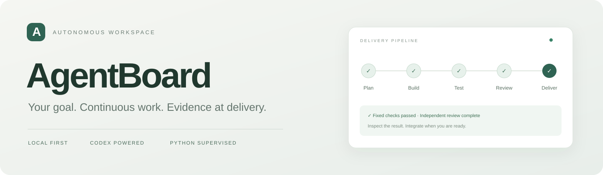
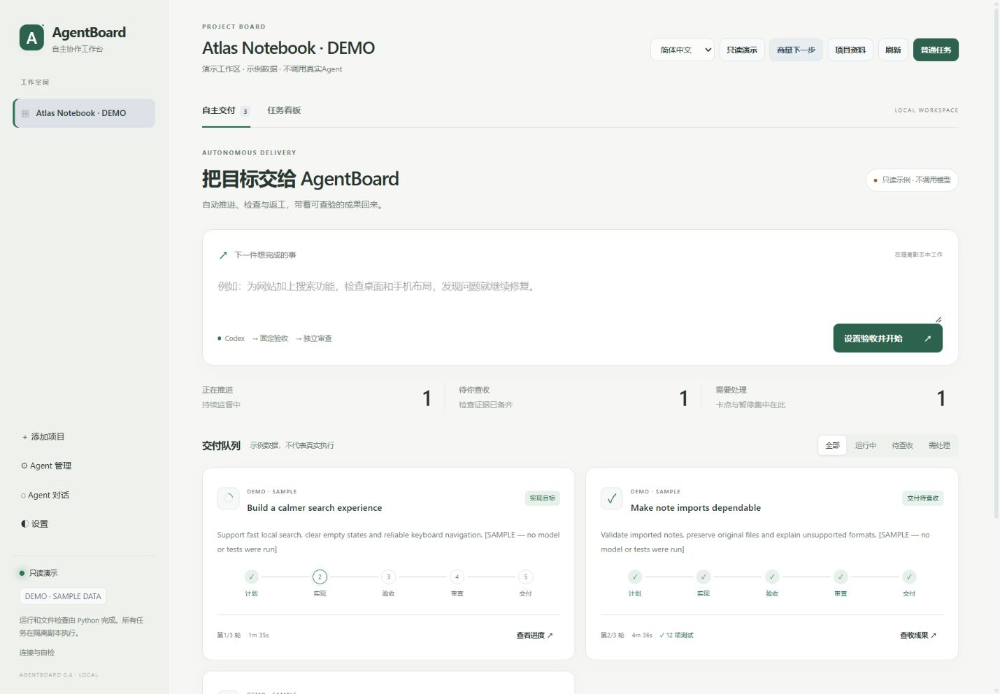

<p align="center"></p>

<p align="center"><strong>让 Codex 自己规划、实现、检查和返工的本地工作台。</strong><br>交给它一个目标，回来查看有证据的成果。</p>

<p align="center"><a href="README.md">English</a> · <a href="docs/新手指南.md">新手指南</a> · <a href="docs/AUTONOMY.md">自主交付使用说明</a> · <a href="docs/SETUP.md">首次配置</a> · <a href="CHANGELOG.md">版本记录</a></p>

## 从“让 AI 回答”走向“让 AI 交付”

AgentBoard 把一次任务接着往前推进：Codex 先制定计划，在项目副本里写代码；Python 跑事先固定的验收；另一轮 Codex 独立审查；发现问题就把具体反馈送回去修改。通过后，你查收成果，再决定接入原项目。

| 你交代目标 | AgentBoard 持续推进 | 你验收成果 |
| --- | --- | --- |
| 选项目，写目标，确定允许修改的文件和验收办法。 | 计划 → 实现 → 程序验收 → 独立审查 → 有限返工。 | 查看测试、截图、审查意见、代码差异和交付报告。 |



*公开截图来自内置只读演示。示例卡片用于说明界面，不代表真实 Agent 已完成这些任务。*

## 0.4 新增了什么

本次源码更新包含自由讨论、聊天内创建与切换项目，以及任务和项目回收站。Windows 本地 176 项离线测试通过，已检查桌面/手机布局、模拟讨论、创建与关联项目、删除恢复和草稿保留。

- **先聊想法，再选项目。** 点“Agent 对话”直接进入自由讨论，默认 Codex，不必先建文件夹。聊天顶部可随时选已有项目；切换时保留未发送的文字，自由讨论不自动带入项目资料或源码。
- **聊清楚后再关联。** 可以明确把空闲讨论关联到已有项目，也可以“从这段讨论新建项目”，保留聊天历史。需要创建新文件夹时明确勾选；新建项目本身不会调用模型或开工。切去别的对话时，正在进行的回复继续在后台运行。
- **不用的卡片先收起来。** 项目和任务可移到回收站，之后恢复。删除项目会隐藏旗下任务和聊天，保留本地文件、历史成果和已接入的改动。恢复不会自动开始任务，也不会撤销代码改动。
- **可以接着做。** 用 SQLite 保存阶段、事件和检查结果。软件重启后从记录恢复；你暂停的任务会继续保持暂停。
- **验收独立于写代码。** 开工前锁定已有验收文件的哈希。找不到实际测试不能算通过，只检查语法也不能算交付。
- **另一轮 Codex 审查。** 在只读快照里检查成果和验收证据。发现严重问题就退回修改，受轮数与总时间限制。
- **真实网页证据。** 使用本机 Edge/Chrome 在桌面和手机尺寸打开静态网页，保存截图，核对真实页面尺寸、横向溢出与可见文字。截图和文字检查不能替代交互测试与人工审美判断。
- **随时掌控进度。** 暂停、继续、停止；每次模型调用最多 25 分钟，另设总时间、返工次数和无进展限制。监督由 Python 完成。
- **更清楚的工作台。** 首页直接输入目标，按状态查看交付，打开报告看进度；保留原任务看板、中英切换、三种主题和右侧聊天区。
- **连接自检与稳妥重启。** 检查 CLI、登录、真实额度、浏览器和数据库。仅在没有运行任务和聊天时重启后台，不影响其他 Python 程序。

## 讨论、任务和项目资料连起来

可以先自由讨论，确定方向后再关联项目。聊天顶部切换“这次聊什么”，会打开所选范围的另一段对话；想把已有记录放到某个项目，要明确点击关联按钮。关联会保留历史、解除原任务关联，并提示重新核对旧共识。

项目可以关联开发日志、交接文件、本地文档和网页。公共消息让参与成员分别回复，斜杠点名只调用对应 Agent。聊天中的“转成任务卡”创建普通任务草稿；需要持续验收、审查和返工时，从“自主交付”开始。任务胶囊、保护文件、差异查看、查收接入和带哈希保护的恢复功能继续保留。

新的自主交付循环使用 Codex。DeepSeek Harness、自定义 CLI/API 执行器继续支持各自已有的任务或讨论能力，没有自动套用新的 Codex 审查循环。没有账号也可以用模拟执行器验证配置。[执行器说明](docs/AGENTS.md) · [模型与推理设置](docs/MODEL_SETTINGS.md)

## 开始使用

应用需要 Python 3.10 或更高版本。网页没有前端编译步骤，Python 不需要安装第三方包。

```bash
git clone https://github.com/wangzane355-cmyk/AgentBoard.git
cd AgentBoard
python demo.py
```

只读演示入口：**http://127.0.0.1:8766/**，不会调用模型。

使用自己的项目：

```bash
python launch.py
```

Windows 也可以双击 `start.cmd`，打开 **http://127.0.0.1:8765/**。可以先自由讨论，准备开工时再添加项目文件夹、关联资料。真实任务需要安装并登录 [官方 Codex CLI](https://github.com/openai/codex)，AgentBoard 复用本机登录。Node 测试需要 Node；网页检查需要 Node 22+ 和已安装的 Edge/Chrome，不需要下载 npm 包。连接自检不会调用模型。[详细配置](docs/SETUP.md)

1. 还没想清楚就先点“Agent 对话”；目标明确后，在“自主交付”写一个具体的小目标。
2. 选择固定验收方案、修改范围和限制。可以只存草稿，也可以明确开始。
3. 查看进度，或让后台继续运行。失败会进入返工。
4. 打开交付报告与代码差异。“查收接入”才修改原项目；接入后没有后续冲突时，可以恢复原文件。

## 真实限制，说清楚

额度保护读取当前 Codex 登录账号实际提供的窗口，包括只提供每周额度的账号。任何可读取窗口剩余到 15%、读数过期、读取失败或账号受限时，阻止新的 Codex 调用。不能读取五小时额度时就显示不可用，不根据每周额度推算。执行器报告的 Token 数也不代表账号剩余额度。

默认同一时间跑一个自主任务，可通过环境设置选择两个。每个任务仍有自己的检查和时间限制。群聊仍然最多六条回复，点名消息不会偷偷扩成全员调用。

**当前是以 Windows 为主要实测环境的本地早期版本。** 项目副本和文件哈希不能替代操作系统安全隔离，适合可信项目。服务只绑定本机，未提供公网登录与多用户权限系统。私人配置、聊天、日志和工作副本不进入源码发行包。交付不会自动发布 GitHub，也不会自动接入原项目；源码文件的删除不会自动接入。

断点恢复需要 Python 服务重新启动，本版没有安装开机系统服务。恢复依靠保存的工作和新 Codex 会话，不代表模型进程永远在线。通用网页点击自动化、长对话自动总结和逐 Token 聊天显示尚未实现。Linux/macOS 的真实执行器行为尚未完整验证。

## 开发与本地打包

```bash
python -m unittest discover -v
node --check static/autonomy.js
python doctor.py
python package_release.py
```

离线测试使用临时项目和模拟模型回复；消耗真实模型用量的试跑单独进行。打包按明确的公开文件清单生成 ZIP 和 SHA256 校验清单，排除私人运行数据。当前 0.4 本地成果与 GitHub 已发布版本分别记录。

[架构](docs/ARCHITECTURE.md) · [参与开发](CONTRIBUTING.md) · [安全边界](SECURITY.md) · [交接指南](DEEPSEEK_HANDOFF.md) · [同类产品研究与来源](docs/AUTONOMY_RESEARCH_2026-11-03.md)

## 许可

[MIT](LICENSE)。使用 Python 标准库与原生 HTML/CSS/JavaScript。AgentBoard 独立于 OpenAI 和 DeepSeek，外部执行器有各自许可与条款。看板交互参考了 [Vibe Kanban](https://github.com/BloopAI/vibe-kanban) 等产品，未打包其代码。
