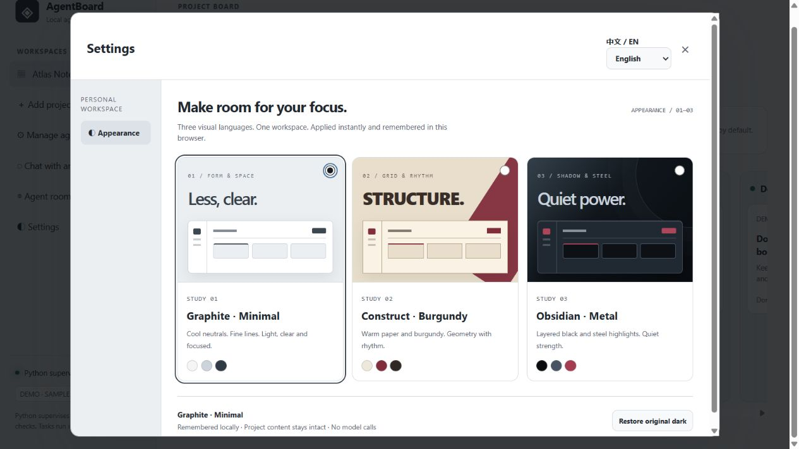
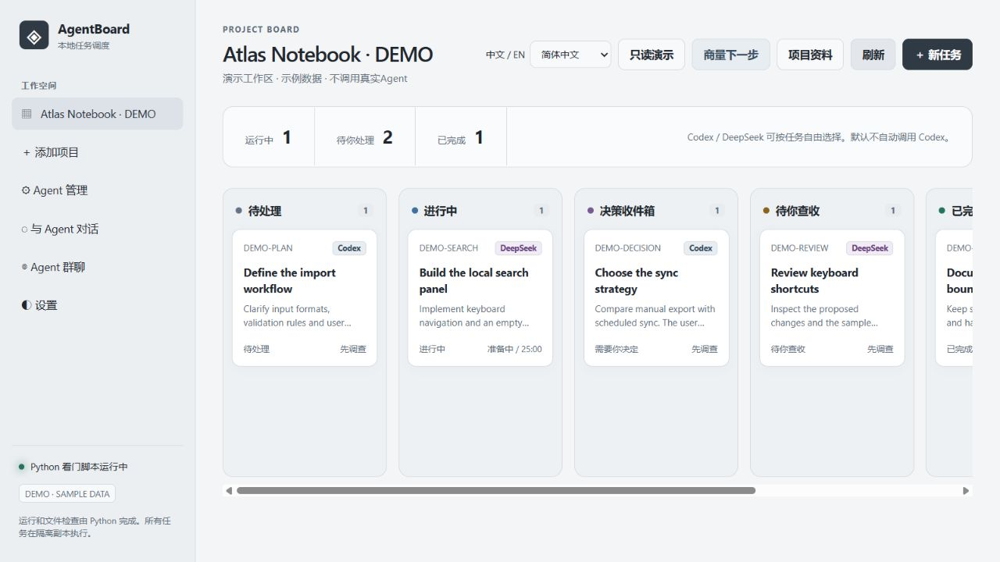
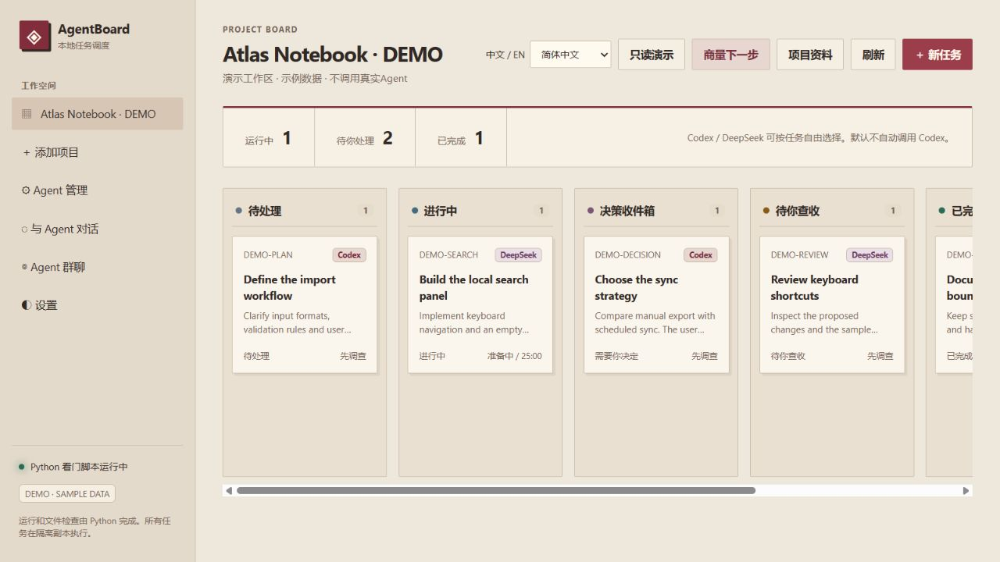
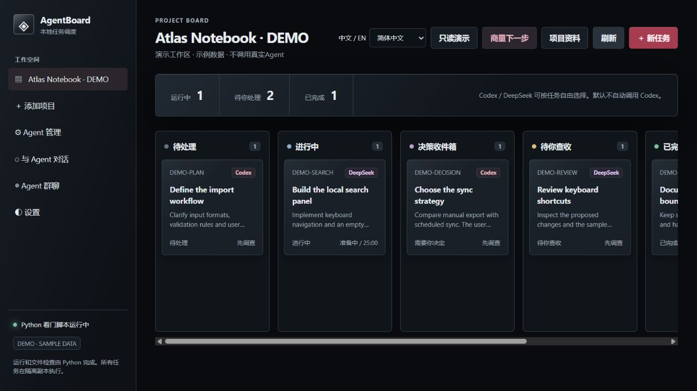
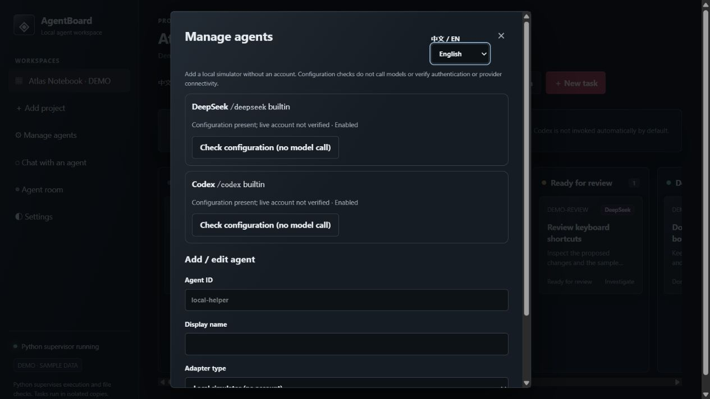

<p align="center"></p>

<p align="center"><strong>把计划讨论、任务分工与交付查收，放进同一个本地工作台。</strong></p>
<p align="center"><a href="README.md">English</a> · <a href="docs/SETUP.md">环境配置</a> · <a href="docs/ARCHITECTURE.md">架构说明</a> · <a href="CONTRIBUTING.md">参与开发</a></p>

AgentBoard 是一个本地运行的 Codex / DeepSeek 任务看板。两种 Agent 共用项目背景与讨论记录，Python 负责计时、文件范围检查、保护文件哈希及交付证据。

## 界面预览


以上来自内置只读演示，任务与对话均为明确标注的示例数据，不代表真实模型执行记录。

### 外观偏好

在“设置 → 外观”选择静灰、构成或黑曜，支持即时切换、键盘选择和本机记忆，也可恢复原始深色。[设计说明](docs/APPEARANCE.md)



<details>
<summary>展开对比三种工作区外观</summary>

| 静灰 · 极简 | 构成 · 酒红 | 黑曜 · 金属 |
| --- | --- | --- |
| [](docs/assets/theme-graphite.jpg) | [](docs/assets/theme-construct.jpg) | [](docs/assets/theme-obsidian.jpg) |

</details>

## 0.2.2 新版内容

| 更新 | 可以做什么 |
| --- | --- |
| Agent 管理 | 保留 Codex / DeepSeek，添加命令行或兼容 API，也能先用无需账号的本地模拟器演练 |
| 群聊成员选择 | 自选受邀成员，用 `/成员ID` 定向发言，继续保留最多六次回复的限制 |
| 本机偏好 | 中英界面切换、三套原创主题，不消耗模型用量 |
| Windows 启动修复 | 修复静默桌面快捷方式的空响应；重开时确认网页正常响应 |

API接入仅支持讨论和只读调查，命令行开发能力需单独启用。“检查配置”不调用模型，也不代表账号登录或服务连接已经验证。[接入说明](docs/AGENTS.md) · [完整开发日志](CHANGELOG.md)

<details>
<summary>查看 Agent 管理界面</summary>



上图是只读演示界面，本机配置存在不等于真实账号已经通过验证。

</details>


## 主要功能

页面顶部和弹窗内可切换中文 / English，浏览器会记住选择。切换不会清空草稿，也不会翻译项目名称、任务正文、聊天原文或日志，不产生翻译模型用量。

| 环节 | 可以做什么 |
| --- | --- |
| 商量计划 | 自动带入关联日志、任务目标和依赖；不用反复介绍背景 |
| Agent 群聊 | 全体回复、斜杠定向、最多三轮的互相接话 |
| 整理任务 | 保存共识、生成草稿、更新关联任务、指定执行者 |
| 执行监督 | 隔离副本、默认25分钟、可改路径和验收规则 |
| 查收交付 | Python逐项证据、文字差异、任务胶囊、人工接入 |
| 文件撤回 | 保留接入前备份，拒绝覆盖后续的新编辑 |
| Codex 额度 | 自动读取五小时余额，剩余不高于15%或读取失败时停止新调用 |

## 快速体验

只需要 Python 3.10+，Python 运行时无需第三方依赖：

```bash
git clone https://github.com/wangzane355-cmyk/AgentBoard.git
cd AgentBoard
python demo.py
```

打开 **http://127.0.0.1:8766/**。这是只读演示，不需要AI账号，也不会调用模型。

## 使用自己的项目

1. 按[配置指南](docs/SETUP.md)安装并登录要使用的 Codex CLI 或 DeepSeek Harness。
2. 运行 `python launch.py`；Windows 也可双击 `start.cmd`。
3. 打开 **http://127.0.0.1:8765/**，添加本地项目。
4. 在“项目资料”关联开发日志、交接文档或网页；先预览再保存。
5. 点击“商量下一步”或“Agent群聊”，讨论后保存共识并生成任务卡。
6. 核对允许范围和验收条件，启动执行；通过检查后由用户决定是否接入。

首次启动是空工作区。每位用户使用自己的账号、额度与本地路径。

## 群聊命令

- 普通消息发给全体：每位成员依次回复一次。
- `/codex 你的问题`：只调用Codex。
- `/deepseek 你的问题`：只调用DeepSeek。
- `/讨论 2 你的方案`：允许互相接话，最多两轮、四次回复。

定向消息仍在共享历史中，其他成员下次受邀时才能读取，不会为“保持安静”额外调用模型。最多三轮、六次回复，单批次总时限25分钟；可以随时停止。群聊同样支持任务关联、共识保存和转成任务卡。

## 自动检查的边界

这是早期版本，主要在Windows上手动验证。Linux/macOS的真实执行器链路尚未完整验证。

侧栏“Agent管理”支持添加本地模拟、命令行执行器和兼容API。没有新账号也能用模拟器验证任务、定向消息和群聊；模拟不会执行真实开发。API仅支持讨论和只读调查，命令行开发需单独启用。配置检查不调用模型，也不代表真实账号连接成功。详见[接入说明](docs/AGENTS.md)。

Python可以检查进程、文件变化、保护文件、原项目并发改动以及配置的规则。没有编译或测试证据时会标出空缺，画面、手感和需求取舍仍由人判断。隔离副本与事后检查不等于操作系统权限隔离。

服务只监听本机回环地址，没有公网部署和多人认证层。私人数据在 `data/`，执行副本默认在 `~/AgentBoardWork/`，都不应公开上传。Codex额度保护依赖ChatGPT登录方式提供的窗口，纯API Key配置可能无法提供该读数，因此会被拦下。

回复目前整段返回，没有逐字流式输出，也没有自动压缩全部历史。更多限制见[英文说明](README.md#status-and-boundaries)与[安全说明](SECURITY.md)。

## 开发与许可

```bash
python -m unittest -v test_server.py test_context_sources.py test_group_chat.py test_agent_registry.py test_launch.py
```

离线测试不会调用模型；真实模型试跑脚本需要单独手动运行。详见[贡献指南](CONTRIBUTING.md)。

采用[MIT许可证](LICENSE)。本项目独立开发，不代表OpenAI或DeepSeek官方产品；相关执行器按其各自许可提供。

