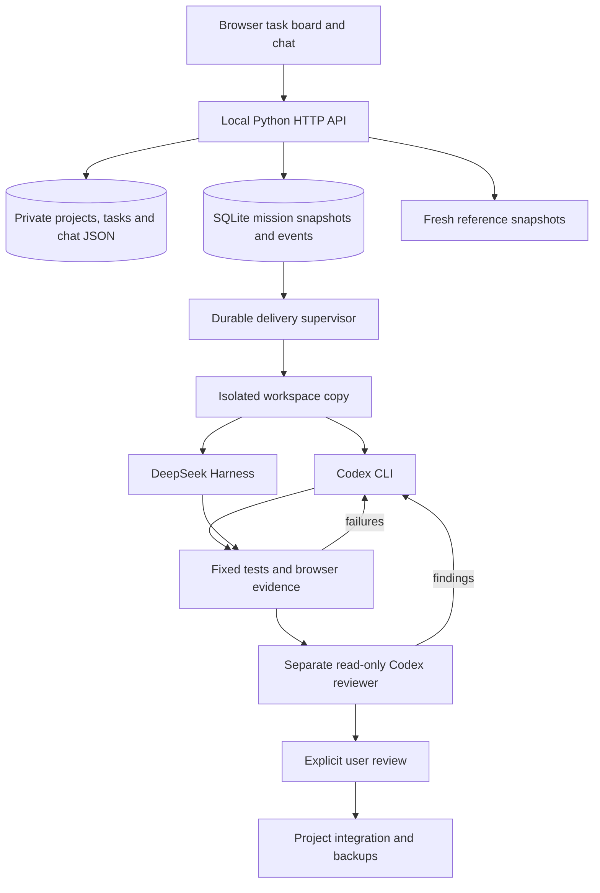

# Architecture

AgentBoard has a small local runtime: a standard-library Python HTTP service and plain HTML/CSS/JavaScript.

## Files

| Module | Responsibility |
| --- | --- |
| `server.py` | HTTP routes, persistent state, jobs, checks, integration and rollback |
| `autonomy.py` | Durable mission lifecycle, recovery, limits, concurrency and no-progress detection |
| `autonomy_store.py` | SQLite WAL snapshots, revisions, events and supervisor ownership |
| `autonomy_bridge.py` | Compatible task links, context, CLI calls, reviewer snapshots and receipts |
| `supervised_process.py` | Owned child identity, cancellation, timeout and JSONL evidence |
| `verification.py` | Validated recipes, immutable test hashes, test counts and browser evidence |
| `context_sources.py` | Bounded local/web reference extraction with provenance |
| `group_chat.py` | Deterministic slash routing and handoff parsing |
| `usage_probe.py` | Read-only Codex account quota query |
| `static/app.js` | Task board and review drawer |
| `static/autonomy.js` / `workspace.css` | Goal-first workspace and delivery evidence UI |
| `static/chat.js` | Conversations, group routing UI and task drafts |
| `static/context.js` | Reference selection and previews |
| `demo.py` | Isolated, read-only sample workspace |
| `doctor.py` / `restart_service.py` | Read-only diagnostics and idle service replacement |
| `package_release.py` | Public-source whitelist archive and SHA256 manifest |

## Task lifecycle

Ordinary tasks keep their single-attempt lifecycle. Autonomous missions persist plan/build/check/review/repair phases in SQLite. A source copy establishes the original, protected-file and fixed-test baselines. Failed checks or reviewer findings return to implementation within bounded rounds and time. A separate read-only snapshot and new Codex session review actual evidence. Successful delivery yields a report; it does not automatically integrate code.

Every transition commits a mission snapshot and event transactionally. Recovery verifies recorded PID plus creation identity before continuing; unknown live identities pause rather than start duplicate work. Interrupted model phases may repeat; completed checkpoints are reused. Default concurrency is one autonomous worker, opt-in two. No UI refresh starts work.

The bridge mirrors durable missions into legacy tasks/runs idempotently. Final workspace hashes are checkpointed before delivery and never recalculated merely because the service restarted. A single owner claims each private data directory to prevent two live schedulers.

Integration checks source drift and protected files again. Changed originals are backed up. Rollback validates that integrated files still match the recorded result before restoring them.

## Chat lifecycle

Messages are stored in one room history. Each model call receives bounded recent history, the original batch question, linked consensus, project briefing and fresh reference snapshots. These are explicit context transfers, not shared model memory.

Broadcasts invoke members sequentially, once each. Directed commands cannot invite additional recipients. In discussion mode, validated handoff markers may append a member to the queue while the human-selected reply budget and deadline remain available.

## Evidence boundary

Python checks exit codes, actual test counts, paths, hashes and configured browser captures. Zero discovered tests and syntax-only acceptance cannot establish autonomous delivery. Existing acceptance files are locked before work. Codex exec JSON records sessions and reported tokens; unavailable model confirmation remains unavailable. Token use is not subscription capacity.

Browser DOM checks and PNGs provide limited evidence; they do not establish all interaction behavior or visual quality. Independent model review is another judgement, not a correctness guarantee. Missing checks remain visible.

Runtime JSON, SQLite WAL files, transcripts, prompts, receipts and source copies stay in private data/workspace roots excluded from Git and source packages. File hashes do not replace an OS security boundary. No public-hosting authentication or automatic remote publication is included.
