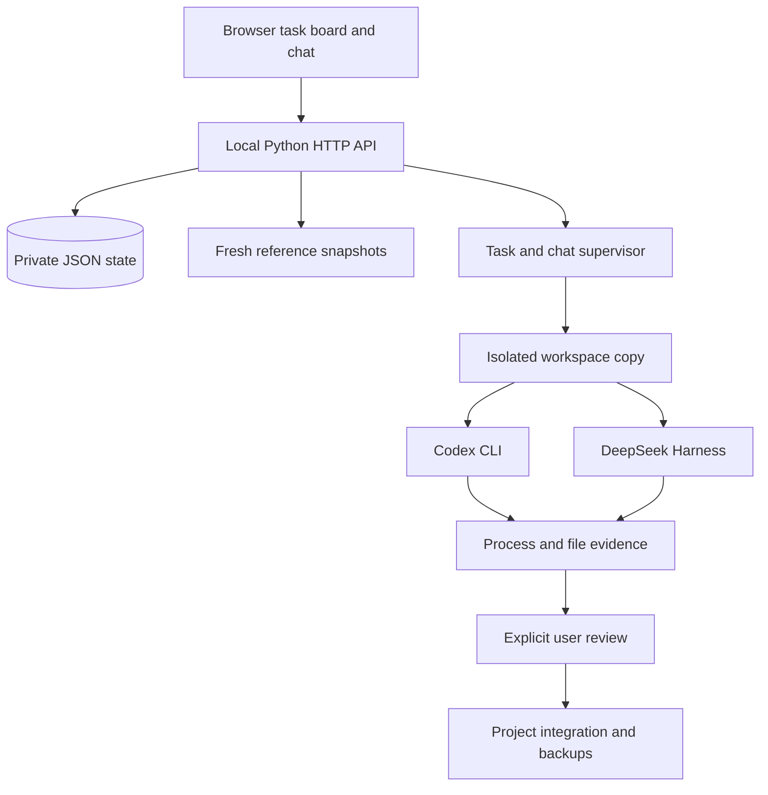

# Architecture

AgentBoard has a small local runtime: a standard-library Python HTTP service and plain HTML/CSS/JavaScript.

## Files

| Module | Responsibility |
| --- | --- |
| `server.py` | HTTP routes, persistent state, jobs, checks, integration and rollback |
| `context_sources.py` | Bounded local/web reference extraction with provenance |
| `group_chat.py` | Deterministic slash routing and handoff parsing |
| `usage_probe.py` | Read-only Codex account quota query |
| `static/app.js` | Task board and review drawer |
| `static/chat.js` | Conversations, group routing UI and task drafts |
| `static/context.js` | Reference selection and previews |
| `demo.py` | Isolated, read-only sample workspace |

## Task lifecycle

Tasks move through ready/queued, running, review, done or blocked. A worker copies the source, establishes a baseline, executes one CLI process and evaluates independent checks. Successful completion yields a review card; it does not automatically integrate code.

Integration checks source drift and protected files again. Changed originals are backed up. Rollback validates that integrated files still match the recorded result before restoring them.

## Chat lifecycle

Messages are stored in one room history. Each model call receives bounded recent history, the original batch question, linked consensus, project briefing and fresh reference snapshots. These are explicit context transfers, not shared model memory.

Broadcasts invoke members sequentially, once each. Directed commands cannot invite additional recipients. In discussion mode, validated handoff markers may append a member to the queue while the human-selected reply budget and deadline remain available.

## Evidence boundary

Python can check exit codes, paths, hashes, configured compilation and simple assertions. It cannot infer visual quality or product correctness from a worker's text. Missing checks remain visible. The same distinction should be maintained by future adapters and UI changes.
