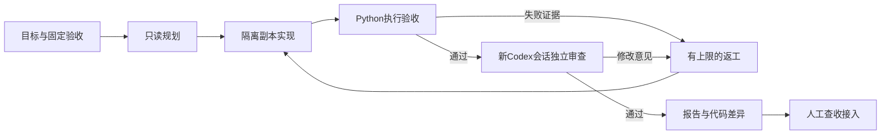

# 自主交付 / Autonomous delivery

## 给第一次使用的人

你可以把 AgentBoard 理解成一个有检查流程的本地工作室。Codex 负责思考与写代码，Python 负责计时、保存进度、运行验收和决定是否需要返工。完成后先交给你查收，再接入原项目。

1. 添加本地项目，关联 README、开发日志和交接文件。
2. 在“自主交付”写清楚目标，例如“修复列表筛选，加入测试，兼容手机屏幕”。
3. 选择验收方案、允许修改的文件、最多几轮和总时间。可以保存项目常用验收方案，也可以先只存草稿。
4. 明确点击开始。刷新、切语言、切主题都不会调用模型。
5. 成功后打开报告，看测试、审查意见、截图与差异；点击“查收接入”才修改原项目。

后台继续运行时任务会自行推进。关闭浏览器不等于停止任务；关闭电脑会中断执行，重新启动 AgentBoard 后按记录恢复。本版没有安装开机系统服务，不能在电脑关机时继续计算。

## 工作循环

规划和审查使用只读执行设置，审查另建快照。模型调用通过已安装 Codex CLI 的 exec JSON 事件执行，复用本机登录。每个阶段是新会话，交接靠保存的目标、计划、文件和证据。没有迁移为长期 app-server 对话；app-server 当前用于真实额度读取。

## 验收方案

| 类型 | 实际执行 | 限制 |
| --- | --- | --- |
| Python 单元测试 | unittest 模块或发现测试 | 零条实际测试不能通过 |
| Node 测试 | node --test | 需要本机 Node；零测试不能通过 |
| 语法检查 | 编译 Python 源文件，不写缓存 | 不能单独作为交付依据 |
| 已有命令 | 参数数组形式的 unittest/pytest、node、npm test/run | 不执行任意 shell 字符串；pytest 等工具需自行安装 |
| 网页 | Node 22+ 配合本机 Edge/Chrome 打开静态 HTML，核对真实尺寸、溢出、可见文字和 PNG | 默认1440×900和390×844；不是通用交互测试 |

开工前保存已有验收文件的哈希。改动验收文件、越出修改范围、原项目变化、保护文件变化都会拦截交付。检查失败和超时反馈给实现者。网页文字读取实际渲染的 innerText，并核对精确视口及页面横向溢出；这些证据不能保证所有可访问性或交互正确；重要行为仍应写测试或人工验证。

开始前没有现成测试的项目，可先把“建立验收”作为独立任务，人查看测试后再用于下一次自主任务。Agent 自己新建的测试不能冒充事先独立确定的验收。

交付待查收时可点击“重新验收与审查”。系统保留旧证据，重跑检查与独立审查，不重复已完成的实现；如果发现新问题，仍会按剩余限制返工。

## 停止与恢复

- **暂停**：结束当前任务拥有的子进程，保存当前阶段，等待你继续。
- **继续**：从最近可验证的阶段继续。中断的模型调用重新执行，不代表原模型进程仍在线。
- **停止**：取消任务，保留本地记录，不再自动推进。
- **需要处理**：时间、额度、范围、无进展或用户决定等条件阻止继续，查看具体原因。
- **交付待查收**：程序检查与独立审查通过，原项目尚未被覆盖。

默认最多3轮实现，总时限90分钟；单次调用最多25分钟。最多可设6轮、总时限720分钟。连续两轮源文件与失败证据没有进展时停止循环。输出长时间无活动也会终止该轮。遇到真实额度保护条件时停止新的模型调用。

SQLite 以事务保存任务快照、递增版本和事件历史。恢复前核对 PID 与创建时间；不能确认身份时暂停，避免误结束复用 PID 的其他程序。一个数据目录只允许一个活动监督器。进度数据库与旧任务 JSON 通过可恢复的任务链接同步。

## 环境与诊断

侧栏“连接与诊断”检查本机 CLI、登录、可读取额度、浏览器和数据库，不向模型提问。更新后页面提示需要重启时，可在无活动任务和聊天时重启。只处理匹配的 AgentBoard 服务。

| 环境变量 | 用途 |
| --- | --- |
| `AGENTBOARD_DATA_DIR` | 私人状态、数据库和运行记录 |
| `AGENTBOARD_WORKSPACES_DIR` | 隔离项目副本 |
| `AGENTBOARD_AUTONOMOUS_WORKERS` | 1（默认）或2个自主任务并行 |
| `AGENTBOARD_BROWSER_EXECUTABLE` | 可选的本机 Edge/Chrome 可执行文件 |

模型与推理强度跟随本机默认值，也可在已有模型设置中选择。界面区分“请求的设置”与“执行器确认的设置”。JSON 日志没确认型号时只显示本机默认，不编造型号。

## 已实现、实测与后续方向

0.4 的监督循环、程序验收、独立审查、暂停继续、进度恢复、报告、显式接入和恢复已实现。离线测试覆盖真实本地子进程、崩溃恢复、进程身份、修复循环及数据完整性；使用模拟模型，不消耗模型用量。

真实 Codex 试跑与离线测试分开记录：调度模块任务验证自动返工；静态网页任务验证双尺寸截图、独立审查及暂停后重启恢复。演示页面的样例卡片不属于这些实测证据。具体本机结果见私人开发日志，不放进公开发行包。

后续方向包括更广泛的浏览器交互验收、任务隔离与自动合并、更强的安装更新体验、长期上下文摘要，以及更成熟的多模型工作流。当前版本不能承诺无限无人值守或自动保证所有产品质量。
