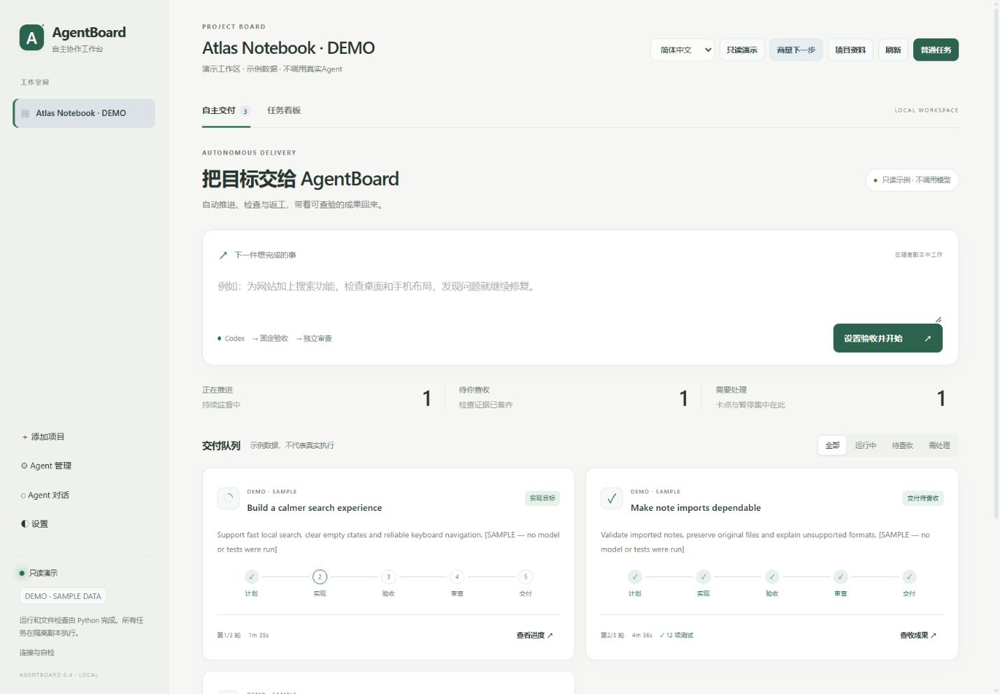

# AgentBoard 新手指南

**你说想做什么 → AI 去做 → 系统检查 → 你看成果 → 满意后接入。**

刚开始，先学会跑一个小任务就够了。下面用一个独立练习，不需要改动你原来的项目。

**先照着前面的 6 步做；后面的说明，需要时再看。**

还没想好做什么？也可以先点左侧 **Agent 对话**，直接聊想法，不必先建项目。聊清楚后，再从聊天里关联或新建项目。

## 第一次，照着做一遍

### 1. 打开 AgentBoard

点击：[打开我的工作台](http://127.0.0.1:8765/)。

如果打不开，先双击桌面的 AgentBoard 启动快捷方式，或者程序文件夹里的 **start.cmd**，再打开网页。

出现“正在启动”提示时，等它自动打开网页即可。启动失败会弹出说明，并告诉你日志在哪里。



*这是演示界面，用来认按钮。你的项目名称和任务会不同。*

### 2. 建一个练习项目

1. 在桌面新建一个空文件夹，叫 **AgentBoard练习**。
2. 打开这个文件夹，点击文件窗口顶部的地址栏，复制文件夹地址。
3. 回到 AgentBoard，点左侧 **＋ 添加项目**。
4. “项目名称”填 **我的第一次练习**；“项目目录”粘贴刚才的地址。
5. 其余先保持默认，点 **添加项目**，再从左侧选中它。

这里的“项目”，就是装这份工作的一个文件夹。

### 3. 告诉它要做什么

在 **自主交付** 页，把下面这段复制到大输入框：

```text
请做一个简单、美观的中文待办清单网页。

页面上明显显示标题：我的待办清单。
添加按钮上的文字：添加。

需要支持：
1. 添加一条待办。
2. 标记完成。
3. 删除待办。
4. 刷新页面后，待办仍然保留。
5. 手机屏幕上也能正常显示。

只使用 index.html、style.css、app.js 这三个文件。
不安装额外依赖。完成后说明实际做了什么、检查了什么。
```

点 **设置验收并开始**。这一步打开设置，还没有正式开工。

### 4. 告诉系统怎么检查

“验收”就是：**怎样知道它做对了？**

照着下面填：

| 界面上的位置 | 这次填什么 |
| --- | --- |
| 任务名称 | 我的第一个待办清单 |
| 在哪个项目中工作 | 我的第一次练习 |
| 怎样证明它做对了 | 网页文字与双尺寸截图 |
| 网页入口 | index.html |
| 页面应该出现的文字 | 见下面两行 |

“页面应该出现的文字”填：

```text
我的待办清单
添加
```

展开 **执行范围与持续运行设置**，把“允许修改的路径”改成这三行：

```text
index.html
style.css
app.js
```

这表示只让它改这三个文件。默认的 `**` 表示允许修改所选项目内的文件，范围更大。

其余先保持默认：**最多 3 轮，累计 90 分钟，重启后继续已勾选**。这些是上限，不是一定要等这么久；每次模型调用最多 25 分钟，遇到问题也可能提前停下。

最后点 **开始自主交付**。如果暂时不想跑，就点 **先保存，不启动**。

### 5. 等它推进，看状态就行

它会自己经历：**计划 → 实现 → 验收 → 审查**。发现问题时，会在限制内返工。

| 看到的状态 | 你要做什么 |
| --- | --- |
| 制定计划、实现目标、程序验收、独立审查 | 继续等，不用反复发送“继续” |
| 根据问题返工 | 它正在按反馈修改，继续等 |
| 交付待查收 | 点 **查收成果** |
| 需要处理、已暂停 | 打开任务，查看具体原因 |

想暂时离开这项工作，用 **暂停并保存**；回来点 **继续推进**。

运行时先不要手动修改这个项目的文件，避免它的工作和你的改动冲突。

**停止任务**会取消这次执行，不能像暂停一样直接继续。

### 6. 打开你的第一个成品

出现 **交付待查收** 后：

1. 点 **查收成果**，看看检查结果和桌面、手机截图。
2. 这是刚才新建的空练习项目。确认后点 **查收并接入原项目**，按提示确认。
3. 打开桌面的 **AgentBoard练习** 文件夹，双击 **index.html**。
4. 亲自试一遍：添加 → 标记完成 → 刷新 → 删除。

**“接入”就是把做好的文件放回你的项目文件夹。待查收时，文件还没有接入。**

截图能检查页面长相，不能证明每个按钮都好用，所以最后这次亲手操作很有用。

## 换成自己的项目时怎么用？

还是同样的流程：**选对项目 → 写一个小目标 → 选验收 → 开始 → 查收。**

例如：

> 把首页的空列表提示改得更清楚，手机上也能完整显示。保留其他功能，运行项目已有的验收，完成后说明修改了哪些文件。

给现有项目关联资料：选中项目，点顶部 **项目资料**，加入 README、开发日志和交接文件，点 **检查并预览读取内容**，再点 **保存关联**。后续讨论和派工会自动带上这些资料。

有现成验收方案时，可以选择 **使用项目验收方案 / 自动识别**。没有方案时，先去 Agent 对话讨论怎么检查，配置好验收再创建任务。上面的网页验收适合能直接打开的 HTML 网页；游戏和其他类型的程序需要适合自己的验收方案。

重要项目接入前，先看 **查看任务与代码差异**。不确定的地方先讨论。接入后如果还没有后续改动，可以用 **撤回本次接入**恢复；文件后来又被修改过时，系统可能拒绝撤回，避免覆盖新内容。

## 想法还没想清楚，先聊

点左侧 **Agent 对话**，会进入 **自由讨论（暂不关联项目）**，默认已经选择 Codex。可以直接发送：

```text
我有一个想法：【写你的想法】。
请用简单的话，帮我想清楚它要解决什么问题，
有哪些做法，以及最适合先做的一件小事。先讨论，不开始开发。
```

看到不懂的词，直接让它“换成普通人能懂的话”。自由讨论不会自动带入项目文件。

聊天顶部的几个入口，这样用：

| 想做什么 | 点哪里 |
| --- | --- |
| 去聊另一个已有项目 | 在 **这次聊什么**里选择项目，会打开该项目的另一段对话 |
| 把正在聊的这段记录放到已有项目里 | 点 **将当前讨论关联到项目**，选项目后确认 |
| 用这段讨论开始一个新项目 | 点 **从这段讨论新建项目**，填写名称和文件夹地址 |
| 单独创建一个项目，另开新对话 | 点 **＋ 新建项目** |

新建时，已有文件夹不用勾选；如果填写的是还不存在的新地址，明确勾选 **这个地址还不存在，为我创建新文件夹**。创建项目本身不会开始开发。

关联后，聊天历史会保留。原来关联的任务会解除，旧共识需要重新核对。已有项目对话的关联按钮叫 **更改当前讨论关联**。

正在回复时，可以切到别的范围，原回复会继续在后台运行。要把这段讨论改关联到项目，先等回复完成，或点 **停止回复**。切换范围和会话时，未发送的文字会保留。

想商量当前项目的下一步，也可以直接点主页顶部的 **商量下一步**。想换回复的 Agent，小窗口里先点聊天顶部的 **设置与历史**，再展开 **会话与设置**。

讨论清楚后，把目标复制回 **自主交付** 再开始。聊天里的 **转成任务卡**目前创建的是普通任务，不会自动进入新的持续验收、返工流程。

群聊中，`/codex 你的问题` 只请 Codex 回复；选择“发给全体”发送普通消息，会让参与成员分别回复。

## 不用的项目和任务，怎么清理？

1. 点任务卡右上角或任务详情里的垃圾桶，删除任务；项目列表行末的垃圾桶用于删除项目。
2. 删错时，可以点短提示里的 **撤销**，或者到左侧 **回收站**，点 **恢复任务 / 恢复项目**。

删除项目会把旗下任务和聊天一起从列表收起来。恢复项目时，这些原来可见的记录会回来；以前单独删除的任务仍留在回收站。如果项目也删了，先恢复项目，再恢复单独删除的任务。恢复任务不会自动开始执行。

**这些删除只整理工作台，保留本地项目文件、历史成果和已经接入的改动。** 如果想撤回代码改动，用前面说的 **撤回本次接入**。

如果任务正在运行、排队，或仍有活跃依赖，系统会拦下删除。按具体提示先停止或处理依赖，再清理。

## 常见问题，只看这一张表

| 问题 | 怎么办 |
| --- | --- |
| 我可以关网页吗？ | 可以。后台还在运行，任务就能继续。 |
| 我可以关电脑吗？ | 关机或睡眠时不能继续工作。想让它跑，保持电脑开机且不睡眠，后台继续运行。 |
| 重开电脑后呢？ | 再启动 AgentBoard。勾选自动继续的未完成任务会按检查点恢复；你主动暂停的任务仍保持暂停。 |
| 怎么突然停了？ | 打开任务看原因。可能是需要你决定、达到时间或轮数上限，或额度保护。把具体提示带回讨论。 |
| 一直没有回复怎么办？ | 先看是否仍在执行、有没有报错，再到左侧 **连接与自检**检查。不要连续重复发送同一条消息。 |
| 找不到验收方案、工具缺失怎么办？ | 暂时不要开始；把具体提示复制到讨论中，让 Agent 帮你整理配置办法。没有有效验收时，也不能保存成任务。 |
| 做完但不满意怎么办？ | 先不要接入，记录具体哪里不满意，再讨论下一项修改。“重新验收与审查”用于再检查当前成果。 |

**第一次的目标：跑完上面这个小练习。熟悉以后，再把同样的流程用到自己的项目。**

需要更多说明时，再看[自主交付说明](AUTONOMY.md)和[首次配置](SETUP.md)。

*当前源码包含自由讨论、聊天内创建项目和回收站入口，已通过本地离线测试与页面验收。*
